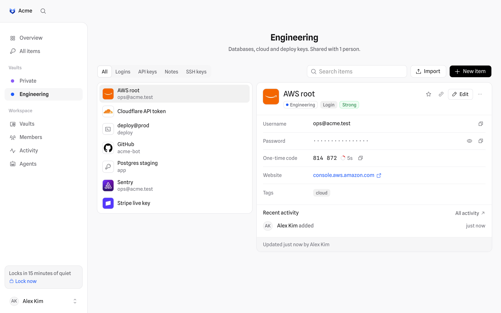

<p align="center">
  
</p>

<p align="center">
  A self-hosted, end-to-end encrypted password manager for small teams.
</p>

<p align="center">
  <a href="https://github.com/jotyy/mima/actions/workflows/ci.yml"></a>
  <a href="LICENSE"></a>
</p>

<picture>
  <source media="(prefers-color-scheme: dark)" srcset="docs/images/items-dark.png">
  
</picture>

mima is for small teams who want one place for their shared logins, API keys and notes, and want to run it themselves. It deploys to your own Cloudflare account (Workers and D1), and every item is encrypted in the browser before it is saved: the server never sees your master password or anything inside an item, not even its name.

## Features

- **End-to-end encrypted.** Your master password never leaves your device. The server stores ciphertext, wrapped keys and public keys, nothing it can read.
- **Two-step login.** Optionally ask for a code from an authenticator app too, with recovery codes for a lost phone. Admins can reset it for a teammate.
- **Vaults for sharing.** Everyone gets a private vault. Shared vaults are opened to people one by one, and taking someone out takes the vault away from them.
- **The items a team actually keeps.** Logins with one-time codes (TOTP), API keys, SSH keys and secure notes, with a password generator and a strength check.
- **Password health.** The Overview points out weak passwords, logins that share one, and items someone could see before they left a vault or the team. It's worked out on your device, because only it can read them.
- **Share links for everyone else.** Send one item to a contractor or a friend through a link that expires, optionally after a single view. It's encrypted on your device and the key travels only in the link.
- **Hard to lose things.** Deleting an item moves it to Recently deleted for 30 days, with Undo right in the notification. A changed password stays under Earlier.
- **An activity log.** Every reveal, copy, share, import and backup is recorded, so the team knows who used what.
- **Move in, move out.** Import CSV exports from 1Password, Bitwarden, LastPass, Chrome, Firefox and Safari. Download a decrypted backup that mima and most password managers can import.
- **A browser extension.** It lists the items saved for the site you're on, fills the login form in one click, and offers to save new logins and changed passwords. See [Browser extension](docs/browser-extension.md).
- **Looks like your tools.** Logins show their site's logo, and so do API keys for well-known services, so the list reads at a glance. Logos come from Brandfetch and can be turned off.
- **Quick to use.** A command palette (<kbd>⌘</kbd> <kbd>K</kbd>) that copies a password without opening the item, a clipboard that clears itself after 90 seconds, light and dark themes, and a layout that works on phones. It installs as an app (PWA).
- **Secrets for scripts and agents, when you need them.** `mima run` hands an item's value to a command without showing it to the agent or script that started it. The first run waits until a person approves it. See [Agents and scripts](docs/agents.md).

## How it works

```
master password ──PBKDF2 (600,000 rounds)──▶ master key ──HKDF──┬─▶ auth key   sent to the server to sign in
                                                               └─▶ wrap key   unlocks your private key
your key pair (ECDH P-256)  receives vault keys from the people who share them with you
vault key (AES-256-GCM)     wraps the key of each item in the vault
item key  (AES-256-GCM)     encrypts one item
```

Everything is WebCrypto, so the browser, the server and the CLI share one implementation in [`packages/crypto`](packages/crypto). The keys live in memory only: a reload, **Lock now** or a few idle minutes forget them. Read [Security](docs/security.md) for the full design, what the server can and can't see, and the limits of the model.

## Quick start

You need [Bun](https://bun.sh) 1.3 or later.

```sh
git clone https://github.com/jotyy/mima.git
cd mima
bun install
cp apps/server/.env.example apps/server/.env   # then set BETTER_AUTH_SECRET
cp apps/web/.env.example apps/web/.env
bun run dev
```

Open <http://localhost:3001>. The first person to visit creates the workspace and becomes its owner; everyone else joins with an invite link.

`bun run dev` runs the whole stack locally (web app on port 3001, API on 3000, a local D1 database) and needs no Cloudflare account.

## Self-hosting

mima deploys to your own Cloudflare account with [Alchemy](https://alchemy.run): one Worker for the API, one for the web app, and a D1 database. Migrations run as part of the deploy.

```sh
cd packages/infra
bunx alchemy profile edit            # connect your Cloudflare account
bunx alchemy deploy --stage production
```

[Self-hosting](docs/self-hosting.md) covers the settings to put in place first, custom domains, upgrades and backups.

## Documentation

- [Self-hosting](docs/self-hosting.md): deploy, configure and upgrade your instance
- [Security](docs/security.md): the encryption design and its limits
- [Browser extension](docs/browser-extension.md): install it and fill logins
- [Agents and scripts](docs/agents.md): `mima run` and approvals
- [Contributing](CONTRIBUTING.md): set up a development environment and send a change
- [Changelog](CHANGELOG.md)

## Project layout

```
apps/
  web/         React app (TanStack Router, React Query, Tailwind CSS)
  server/      API on Cloudflare Workers (Hono, oRPC, Better Auth)
  cli/         mima run, for scripts and agents
  extension/   browser extension: fill and copy on any site
packages/
  crypto/      the end-to-end encryption, shared by the web app and the CLI
  api/         API routes and access rules
  db/          Drizzle schema and D1 migrations
  auth/        Better Auth setup
  ui/          design tokens and components
  infra/       the Alchemy stack: what gets deployed
e2e/           Playwright tests against a full local stack
```

## Contributing

Bug reports, ideas and pull requests are welcome. Read [CONTRIBUTING.md](CONTRIBUTING.md) to get set up, and follow the [Code of Conduct](CODE_OF_CONDUCT.md).

Found a security problem? Please don't open an issue. Report it privately as described in [SECURITY.md](SECURITY.md).

## License

mima is free software under the [GNU Affero General Public License v3.0](LICENSE). If you run a modified version for other people over a network, you must offer them its source code.
